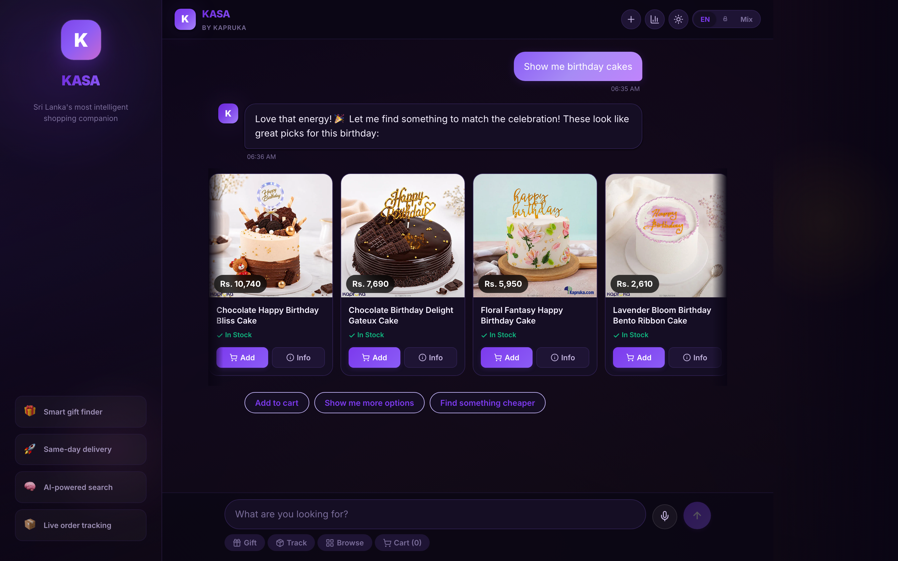
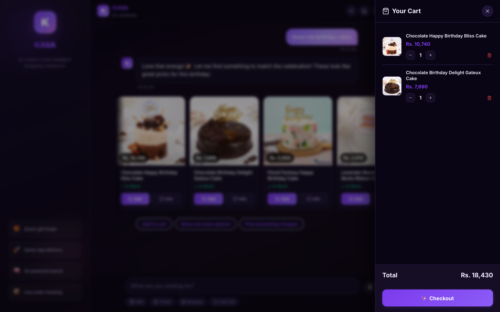
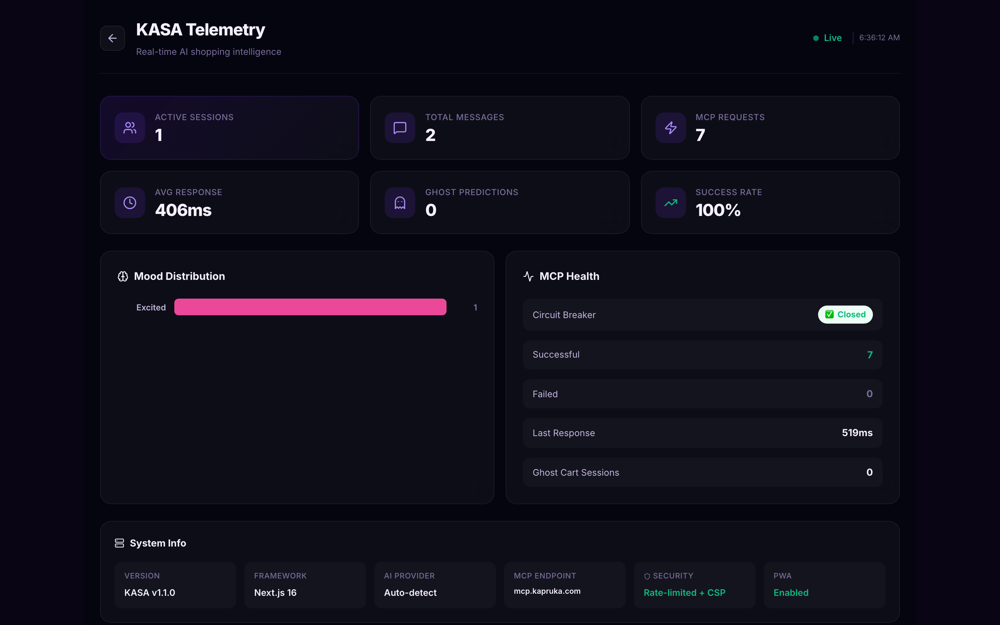
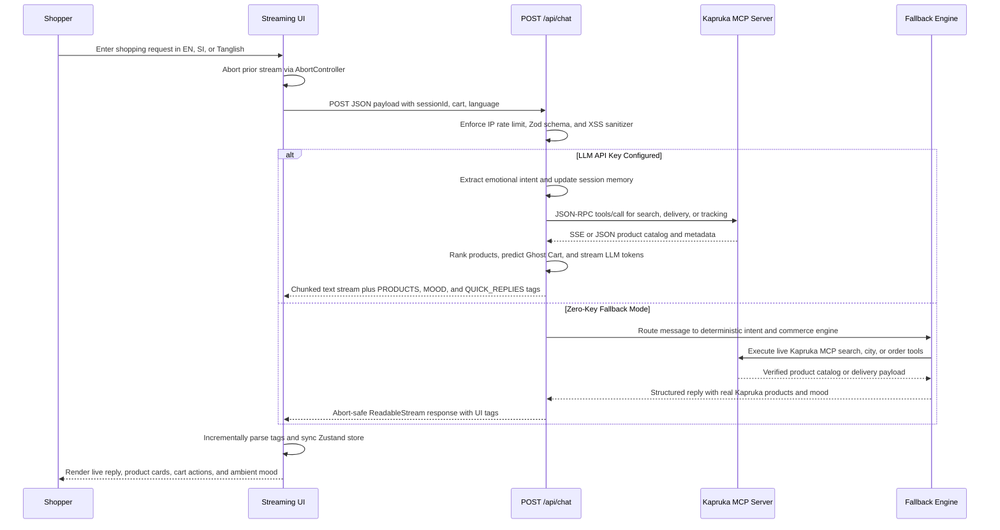

<div align="center">

# KASA — AI Shopping Concierge for Kapruka

**කැස** · Emotionally intelligent, trilingual AI shopping concierge built on the Kapruka Model Context Protocol (MCP) for Sri Lanka's largest e-commerce platform.

[](https://kasa-theta.vercel.app)

[](https://nextjs.org/)
[](https://react.dev/)
[](https://www.typescriptlang.org/)
[](https://sdk.vercel.ai/)
[](https://mcp.kapruka.com)
[](#-overview)
[](LICENSE)

[Live Demo](https://kasa-theta.vercel.app) · [UI Showcase](#-ui-showcase) · [Architecture](#-system-architecture) · [Engineering Highlights](#-frontend--integration-engineering-highlights) · [Getting Started](#-getting-started) · [API Reference](#-api-reference)

</div>

---

## Overview

**KASA** (කැස) transforms e-commerce search and checkout on [Kapruka.com](https://www.kapruka.com) into a natural, empathetic conversation. Supporting **English**, **Sinhala (සිංහල)**, and **Tanglish**, KASA detects user mood and urgency, orchestrates live product search, delivery availability, cart management, guest checkout, and order tracking over the **Kapruka MCP** server, and degrades gracefully to a zero-API-key deterministic engine when LLM credentials are absent.

> **Recognition — Kapruka Agent Challenge 2026**
> Built and submitted as a live AI shopping agent on the Kapruka MCP for the **Kapruka Agent Challenge 2026** (700+ participating developers across Sri Lanka). Awarded the official **Builder Certificate of Participation** by Kapruka Holdings PLC (`REF · NHKZ4`, July 2026).

---

## UI Showcase

### Conversational Product Discovery
Real-time streaming responses with mood detection, live Kapruka MCP product search, dynamic pricing badges, stock verification, and contextual quick-reply actions.



### Slide-Over Cart Drawer & Real-Time Telemetry Dashboard

<table>
  <tr>
    <td width="50%" valign="top">
      <strong>Cart Drawer & Checkout Flow</strong><br/>
      Instant Zustand-backed cart mutations, live LKR subtotals, quantity controls, toast feedback, and conversational checkout handoff.<br/><br/>
      
    </td>
    <td width="50%" valign="top">
      <strong>MCP & Session Telemetry Dashboard</strong><br/>
      Live observability into active sessions, message throughput, Kapruka MCP request latency, circuit breaker health, and mood distribution.<br/><br/>
      
    </td>
  </tr>
</table>

---

## System Architecture


### End-to-End Streaming & MCP Integration Sequence



---

## Frontend & Integration Engineering Highlights

- **Strict End-to-End TypeScript & Runtime Schema Validation:** Built under TypeScript `strict: true` with zero unsafe `any` escapes across client views, Zustand stores, and route handlers. All Next.js API endpoints validate incoming JSON payloads at the boundary with **Zod 4** schemas (`ChatRequestSchema`, `CartSyncSchema`, `DeliveryCheckSchema`, `CreateOrderSchema`, `SuggestionsRequestSchema`).
- **Incremental Streaming UX & `AbortController` Lifecycle:** Streams chunked responses from `/api/chat` into a fault-tolerant incremental tag parser (`<PRODUCTS>`, `<CATEGORIES>`, `<DELIVERY>`, `<ORDER>`, `<QUICK_REPLIES>`, `<MOOD>`, `<CHECKOUT_FORM/>`) while safely cancelling in-flight streams on new chat resets, overlapping requests, or component unmount — both client-side and server-side (`request.signal`).
- **Modular Zustand State Architecture:** Separates ephemeral conversational state (messages, loading state, active cart, dynamic mood, smart suggestions) from selectively persisted shopper preferences (`userName`, `userMemory`) via Zustand `persist` + `partialize`, paired with code-split lazy loading (`next/dynamic`) for secondary commerce drawers and modals.
- **Resilient Kapruka MCP Client & Zero-Key Fallback:** Implements a singleton JSON-RPC 2.0 client over HTTPS + Server-Sent Events (SSE) with session negotiation (`Mcp-Session-Id`), 12-second per-request `AbortController` timeouts, `429 Retry-After` + exponential backoff retries, response integrity verification, automatic circuit-breaker tripping/recovery, live `/api/dashboard` telemetry, and seamless fallback to a deterministic commerce engine when no LLM provider key is configured.
- **Emotion-Aware, Trilingual UX & Production Hardening:** Supports **English**, **Sinhala (සිංහල)**, and **Tanglish** with Web Speech API voice input, emotion-reactive ambient backgrounds, sliding-window IP rate limiting, CSP + security headers, 1-hour TTL session eviction, and multi-stage standalone Docker builds.

---

## Technology Stack

| Layer | Technology |
|-------|------------|
| **Framework** | [Next.js 16](https://nextjs.org/) (App Router, Turbopack, Standalone Output) |
| **Language** | [TypeScript 5](https://www.typescriptlang.org/) (Strict Mode) |
| **UI & Motion** | [React 19](https://react.dev/), [Framer Motion 12](https://www.framer.com/motion/), [Lucide React](https://lucide.dev/) |
| **State Management** | [Zustand 5](https://zustand.docs.pmnd.rs/) |
| **AI Orchestration** | [Vercel AI SDK 6](https://sdk.vercel.ai/) (`@ai-sdk/groq`, `@ai-sdk/google`, `@ai-sdk/openai`) |
| **Commerce Protocol** | [Kapruka MCP Server](https://mcp.kapruka.com) (JSON-RPC 2.0 + SSE) |
| **Validation** | [Zod 4](https://zod.dev/) |
| **Containerization** | Multi-stage Alpine `Dockerfile` & `docker-compose.yml` |

---

## Repository Structure

```text
kasa/
├── app/
│   ├── api/
│   │   ├── cart/sync/route.ts         # Zod-validated cart synchronization & totals
│   │   ├── chat/
│   │   │   ├── route.ts               # Streaming AI + MCP orchestrator & fallback
│   │   │   └── parsed/route.ts        # Parsed chat response helper
│   │   ├── dashboard/route.ts         # Live session, Ghost Cart & MCP telemetry API
│   │   ├── delivery/check/route.ts    # City/date delivery validation via MCP
│   │   ├── order/create/route.ts      # Guest checkout order creation via MCP
│   │   └── suggestions/route.ts       # Context-aware next-best-action suggestions
│   ├── components/                    # 32 modular React 19 UI components
│   │   ├── CartDrawer.tsx             # Slide-over shopping cart with toast feedback
│   │   ├── CategoryGrid.tsx           # Interactive Kapruka categories
│   │   ├── CheckoutForm.tsx           # Recipient & sender checkout flow
│   │   ├── ComparisonTable.tsx        # Side-by-side product comparison
│   │   ├── ErrorBoundary.tsx          # Graceful runtime error boundary
│   │   ├── MoodBackground.tsx         # Emotion-reactive ambient canvas
│   │   ├── NameCaptureCard.tsx        # First-turn personalization prompt
│   │   ├── ProductCard.tsx            # Ranked product cards & KASA's Pick
│   │   ├── TenSecondDecision.tsx      # Countdown impulse-pick widget
│   │   ├── VoiceInput.tsx             # Web Speech API microphone control
│   │   └── WelcomeScreen.tsx          # Localized onboarding workspace
│   ├── dashboard/
│   │   ├── page.tsx                   # Real-time telemetry & MCP health UI
│   │   └── dashboard.css
│   ├── lib/
│   │   ├── ai/                        # Intent, memory, ranker, parser, ghost-cart, tone
│   │   ├── i18n/translations.ts       # English, Sinhala, and Tanglish packs
│   │   ├── mcp/                       # Kapruka MCP JSON-RPC/SSE client & types
│   │   ├── security/rate-limiter.ts   # Sliding-window limiter & sanitizer
│   │   └── store/chat-store.ts        # Zustand client store with selective persist
│   ├── globals.css
│   ├── layout.tsx
│   ├── loading.tsx
│   └── page.tsx
├── docs/
│   └── screenshots/                   # High-resolution UI showcase captures
├── public/                            # PWA manifest, icons, service worker
├── .env.example                       # Environment template
├── Dockerfile                         # Multi-stage production container
├── docker-compose.yml
├── next.config.ts                     # Security headers & image remotePatterns
├── CHANGELOG.md
├── CONTRIBUTING.md
├── DEPLOYMENT.md
├── INSTALL.md
├── LICENSE
└── SECURITY.md
```

---

## Getting Started

### Prerequisites

- **Node.js** `>= 18.18.0` (Node 20/22 LTS recommended)
- **npm** `>= 9.0.0`

### Local Installation

```bash
# 1. Clone the repository
git clone https://github.com/theekshana-sudeepa/kasa.git
cd kasa

# 2. Install dependencies
npm install

# 3. Configure environment variables
cp .env.example .env.local
```

Edit `.env.local` with at least one AI provider key (or leave blank to run in zero-key smart fallback mode with live Kapruka MCP search):

| Variable | Required | Description |
|----------|----------|-------------|
| `GROQ_API_KEY` | Optional* | [Groq](https://console.groq.com) API key (recommended, Llama 3.3 70B) |
| `GOOGLE_GENERATIVE_AI_API_KEY` | Optional* | [Google AI Studio](https://aistudio.google.com/apikey) API key (Gemini 2.0 Flash) |
| `OPENAI_API_KEY` | Optional* | [OpenAI](https://platform.openai.com/api-keys) API key (GPT-4o-mini) |
| `MCP_ENDPOINT` | Optional | Custom MCP endpoint (defaults to `https://mcp.kapruka.com/mcp`) |

> *Providers are evaluated in order: `GROQ_API_KEY` -> `GOOGLE_GENERATIVE_AI_API_KEY` -> `OPENAI_API_KEY` -> Zero-Key Fallback Engine.

### Development & Production Commands

```bash
# Run development server (http://localhost:3000)
npm run dev

# Verify strict TypeScript, ESLint, and production build
npx tsc --noEmit
npm run lint
npm run build

# Start production server
npm start
```

---

## API Reference

| Endpoint | Method | Purpose |
|----------|--------|---------|
| `/api/chat` | `POST` | Streaming conversational endpoint emitting prose + structured UI tags (`<PRODUCTS>`, `<CATEGORIES>`, `<DELIVERY>`, `<ORDER>`, `<TRACKING>`, `<QUICK_REPLIES>`, `<MOOD>`, `<CHECKOUT_FORM/>`) |
| `/api/chat/parsed` | `GET` | Returns latest pre-parsed structured response payload for a session |
| `/api/cart/sync` | `POST` | Zod-validated cart synchronization and subtotal computation |
| `/api/delivery/check` | `POST` | Validates delivery coverage by Sri Lankan city and date via MCP |
| `/api/order/create` | `POST` | Submits Zod-validated guest checkout orders via Kapruka MCP |
| `/api/suggestions` | `POST` | Generates contextual next-best-action shopping prompts |
| `/api/dashboard` | `GET` | Exposes active sessions, mood distribution, Ghost Cart, and MCP circuit-breaker telemetry |

---

## Deployment

KASA is live at **[kasa-theta.vercel.app](https://kasa-theta.vercel.app)** and supports one-click cloud hosting as well as containerized self-hosting. See [DEPLOYMENT.md](DEPLOYMENT.md) for platform-specific guides covering Docker, Vercel, Netlify, Railway, Render, AWS ECS, and Nginx + PM2.

### Quick Deploy to Vercel

[](https://vercel.com/new/clone?repository-url=https://github.com/theekshana-sudeepa/kasa)

### Quick Deploy with Docker

```bash
docker compose up -d --build
```

---

## Security & Privacy

- All API keys remain strictly server-side via environment variables — never exposed to client bundles.
- No database persistence of customer chats; server session state resides in ephemeral memory with automatic 1-hour TTL eviction.
- See [SECURITY.md](SECURITY.md) for security headers and responsible disclosure guidelines.

---

## License

This project is open-source software licensed under the [MIT License](LICENSE).

---

<div align="center">

**Engineered by [Theekshana Sudeepa](https://github.com/theekshana-sudeepa)**

[LinkedIn](https://www.linkedin.com/in/theekshana-sudeepa/) · [GitHub](https://github.com/theekshana-sudeepa) · [LexoraTech](https://lexoratech.com)

</div>
