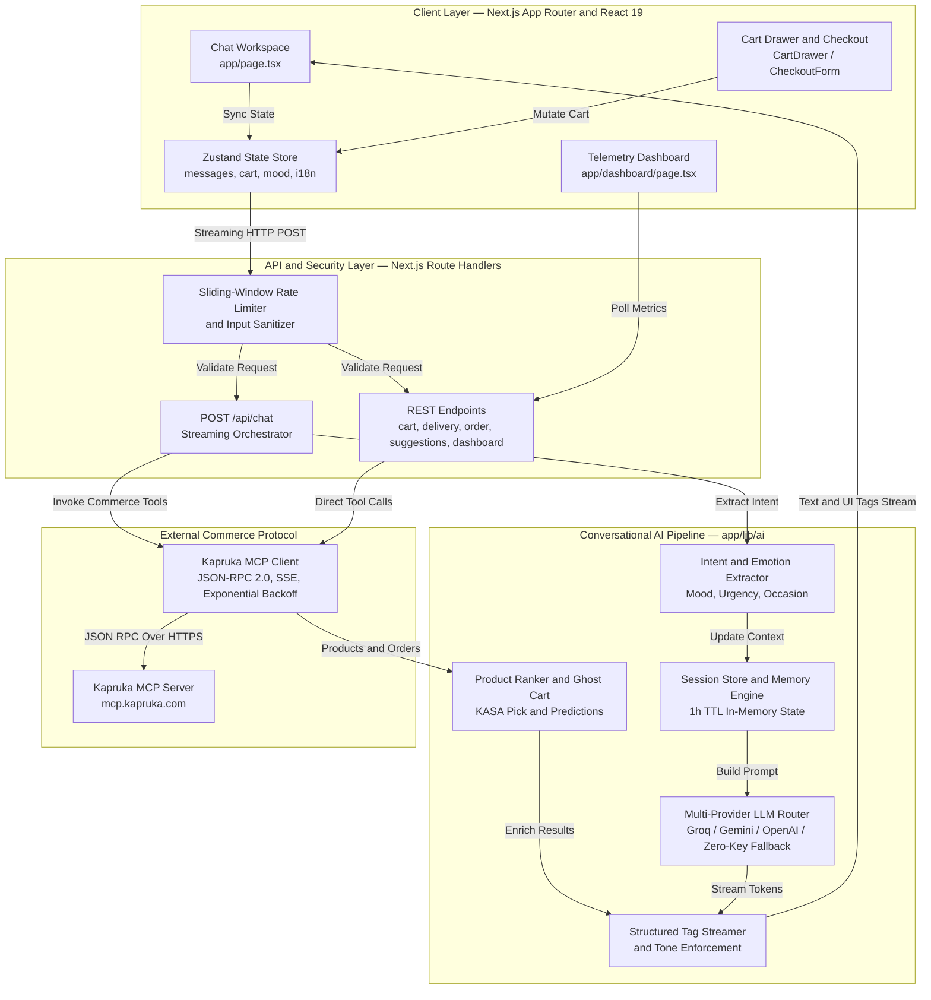
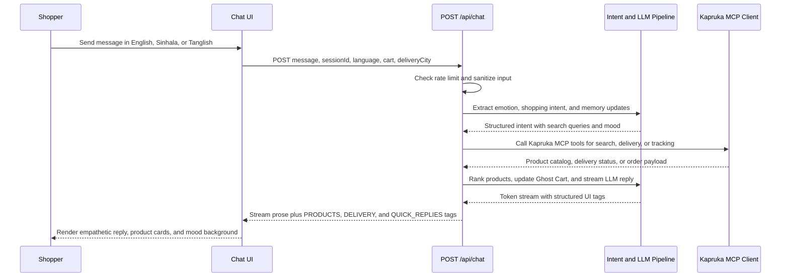

<div align="center">

# KASA — AI Shopping Concierge for Kapruka

**කැස** · Emotionally intelligent, trilingual AI shopping concierge built on the Kapruka Model Context Protocol (MCP) for Sri Lanka's largest e-commerce platform.

[](https://nextjs.org/)
[](https://react.dev/)
[](https://www.typescriptlang.org/)
[](https://sdk.vercel.ai/)
[](https://mcp.kapruka.com)
[](#-recognition)
[](LICENSE)

[Architecture](#-system-architecture) · [Engineering Highlights](#-core-engineering-highlights) · [Getting Started](#-getting-started) · [API Reference](#-api-reference) · [Deployment](#-deployment)

</div>

---

## Overview

**KASA** (කැස) transforms e-commerce search and checkout on [Kapruka.com](https://www.kapruka.com) into a natural, empathetic conversation. Supporting **English**, **Sinhala (සිංහල)**, and **Tanglish**, KASA detects user mood and urgency, orchestrates live product search, delivery availability, cart management, guest checkout, and order tracking over the **Kapruka MCP** server, and degrades gracefully to a zero-API-key deterministic engine when LLM credentials are absent.

> **Recognition — Kapruka Agent Challenge 2026**
> Built and submitted as a live AI shopping agent on the Kapruka MCP for the **Kapruka Agent Challenge 2026** (700+ participating developers across Sri Lanka). Awarded the official **Builder Certificate of Participation** by Kapruka Holdings PLC (`REF · NHKZ4`, July 2026).

---

## System Architecture



### Conversational Request Flow



---

## Core Engineering Highlights

- **Multi-Provider LLM Routing with Zero-Key Fallback:** Dynamically resolves providers in priority order (**Groq Llama 3.3 70B** -> **Google Gemini 2.0 Flash** -> **OpenAI GPT-4o-mini**) via the Vercel AI SDK, and falls back seamlessly to a deterministic commerce engine when no API key is configured.
- **Resilient Kapruka MCP Client:** Implements JSON-RPC 2.0 session initialization (`Mcp-Session-Id`), Server-Sent Events (SSE) stream parsing, `429 Retry-After` handling, exponential backoff retries, response verification, and real-time telemetry tracking.
- **Emotion-Aware Commerce Pipeline:** Detects emotional context (`sad`, `urgent`, `excited`, `anxious`, `romantic`, `neutral`), adjusts visual mood backgrounds, enforces natural non-robotic tone, and prioritizes empathy before recommendations.
- **Trilingual Localization:** Native UI strings and conversational responses across **English**, **Sinhala (සිංහල)**, and **Tanglish**, paired with Web Speech API voice input.
- **Predictive Shopping UX:** Includes **KASA's Pick** product scoring, **Ghost Cart** pre-fetching for likely additions, **10-Second Decision** quick-pick mode, gift message cards, group-gift split links, and live conversation memory.
- **Production Hardening:** Enforces strict CSP and security headers (`X-Frame-Options`, `X-Content-Type-Options`, `Permissions-Policy`), sliding-window IP rate limiting, XSS input sanitization, 1-hour TTL ephemeral server sessions, and standalone multi-stage Docker packaging.

---

## Technology Stack

| Layer | Technology |
|-------|------------|
| **Framework** | [Next.js 16](https://nextjs.org/) (App Router, Turbopack, Standalone Output) |
| **Language** | [TypeScript 5](https://www.typescriptlang.org/) (Strict Mode) |
| **UI & Motion** | [React 19](https://react.dev/), [Framer Motion 12](https://www.framer.com/motion/), [Lucide React](https://lucide.dev/) |
| **State Management** | [Zustand 5](https://zustand.docs.pmnd.rs/) |
| **AI Orchestration** | [Vercel AI SDK 6](https://sdk.vercel.ai/) (`@ai-sdk/groq`, `@ai-sdk/google`, `@ai-sdk/openai`) |
| **Commerce Protocol** | [Kapruka MCP Server](https://mcp.kapruka.com) (JSON-RPC 2.0 + SSE) |
| **Validation** | [Zod 4](https://zod.dev/) |
| **Containerization** | Multi-stage Alpine `Dockerfile` & `docker-compose.yml` |

---

## Repository Structure

```text
kasa/
├── app/
│   ├── api/
│   │   ├── cart/sync/route.ts         # Cart synchronization and totals
│   │   ├── chat/
│   │   │   ├── route.ts               # Streaming AI + MCP orchestrator
│   │   │   └── parsed/route.ts        # Parsed chat response helper
│   │   ├── dashboard/route.ts         # Live session & MCP telemetry API
│   │   ├── delivery/check/route.ts    # City/date delivery validation
│   │   ├── order/create/route.ts      # Guest checkout order creation
│   │   └── suggestions/route.ts       # Context-aware suggestions API
│   ├── components/                    # 32 modular React UI components
│   │   ├── CartDrawer.tsx             # Slide-over shopping cart
│   │   ├── CategoryGrid.tsx           # Interactive Kapruka categories
│   │   ├── CheckoutForm.tsx           # Recipient & sender checkout flow
│   │   ├── ComparisonTable.tsx        # Side-by-side product comparison
│   │   ├── ErrorBoundary.tsx          # Graceful runtime error boundary
│   │   ├── MoodBackground.tsx         # Emotion-reactive ambient canvas
│   │   ├── NameCaptureCard.tsx        # First-turn personalization prompt
│   │   ├── ProductCard.tsx            # Ranked product cards & KASA's Pick
│   │   ├── TenSecondDecision.tsx      # Countdown impulse-pick widget
│   │   ├── VoiceInput.tsx             # Web Speech API microphone control
│   │   └── WelcomeScreen.tsx          # Localized onboarding workspace
│   ├── dashboard/
│   │   ├── page.tsx                   # Real-time telemetry dashboard UI
│   │   └── dashboard.css
│   ├── lib/
│   │   ├── ai/                        # Intent, memory, ranker, parser, ghost-cart, tone
│   │   ├── i18n/translations.ts       # English, Sinhala, and Tanglish packs
│   │   ├── mcp/                       # Kapruka MCP JSON-RPC/SSE client & types
│   │   ├── security/rate-limiter.ts   # Sliding-window limiter & sanitizer
│   │   └── store/chat-store.ts        # Zustand client store
│   ├── globals.css
│   ├── layout.tsx
│   ├── loading.tsx
│   └── page.tsx
├── public/                            # PWA manifest, icons, service worker
├── .env.example                       # Environment template
├── Dockerfile                         # Multi-stage production container
├── docker-compose.yml
├── next.config.ts                     # Security headers & image remotePatterns
├── CHANGELOG.md
├── CONTRIBUTING.md
├── DEPLOYMENT.md
├── INSTALL.md
├── LICENSE
└── SECURITY.md
```

---

## Getting Started

### Prerequisites

- **Node.js** `>= 18.18.0` (Node 20/22 LTS recommended)
- **npm** `>= 9.0.0`

### Local Installation

```bash
# 1. Clone the repository
git clone https://github.com/theekshana-sudeepa/kasa.git
cd kasa

# 2. Install dependencies
npm install

# 3. Configure environment variables
cp .env.example .env.local
```

Edit `.env.local` with at least one AI provider key (or leave blank to run in zero-key smart fallback mode):

| Variable | Required | Description |
|----------|----------|-------------|
| `GROQ_API_KEY` | Optional* | [Groq](https://console.groq.com) API key (recommended, Llama 3.3 70B) |
| `GOOGLE_GENERATIVE_AI_API_KEY` | Optional* | [Google AI Studio](https://aistudio.google.com/apikey) API key (Gemini 2.0 Flash) |
| `OPENAI_API_KEY` | Optional* | [OpenAI](https://platform.openai.com/api-keys) API key (GPT-4o-mini) |
| `MCP_ENDPOINT` | Optional | Custom MCP endpoint (defaults to `https://mcp.kapruka.com/mcp`) |

> *Providers are evaluated in order: `GROQ_API_KEY` -> `GOOGLE_GENERATIVE_AI_API_KEY` -> `OPENAI_API_KEY` -> Zero-Key Fallback Engine.

### Development & Production Commands

```bash
# Run development server (http://localhost:3000)
npm run dev

# Verify lint and production build
npm run lint
npm run build

# Start production server
npm start
```

---

## API Reference

| Endpoint | Method | Purpose |
|----------|--------|---------|
| `/api/chat` | `POST` | Streaming conversational endpoint emitting prose + structured UI tags (`<PRODUCTS>`, `<CATEGORIES>`, `<DELIVERY>`, `<ORDER>`, `<TRACKING>`, `<QUICK_REPLIES>`, `<MOOD>`, `<CHECKOUT_FORM/>`) |
| `/api/chat/parsed` | `POST` | Returns pre-parsed structured response payloads |
| `/api/cart/sync` | `POST` | Synchronizes cart items and calculates totals |
| `/api/delivery/check` | `POST` | Validates delivery coverage by Sri Lankan city and date |
| `/api/order/create` | `POST` | Submits guest checkout orders via Kapruka MCP |
| `/api/suggestions` | `POST` | Generates contextual next-best-action shopping prompts |
| `/api/dashboard` | `GET` | Exposes active session, mood distribution, Ghost Cart, and MCP telemetry |

---

## Deployment

KASA supports one-click cloud hosting and containerized self-hosting. See [DEPLOYMENT.md](DEPLOYMENT.md) for platform-specific instructions covering Docker, Vercel, Netlify, Railway, Render, AWS ECS, and Nginx + PM2.

### Quick Deploy to Vercel

[](https://vercel.com/new/clone?repository-url=https://github.com/theekshana-sudeepa/kasa)

### Quick Deploy with Docker

```bash
docker compose up -d --build
```

---

## Security & Privacy

- All API keys remain strictly server-side via environment variables — never exposed to client bundles.
- No database persistence of customer chats; server session state resides in ephemeral memory with automatic 1-hour TTL eviction.
- See [SECURITY.md](SECURITY.md) for security headers and responsible disclosure guidelines.

---

## License

This project is open-source software licensed under the [MIT License](LICENSE).

---

<div align="center">

**Engineered by [Theekshana Sudeepa](https://github.com/theekshana-sudeepa)**

[LinkedIn](https://www.linkedin.com/in/theekshana-sudeepa/) · [GitHub](https://github.com/theekshana-sudeepa) · [LexoraTech](https://lexoratech.com)

</div>
